  

Desarrollo aplicaciones multiplataforma y la infraestructura Linux que las mantiene en producción: el código de la aplicación, el servidor que la sirve y la red privada que lo protege. Mi criterio es simple: lo que despliego tiene que ser seguro por defecto, no después.

## Actividad

  

## Stack

  

## Cómo despliego

  

La superficie pública se limita a lo imprescindible. La web y la API salen por Nginx con TLS; la administración y los recursos compartidos quedan detrás de WireGuard.

## Proyectos

Trabajo sobre todo en repositorios privados, para clientes y arquitecturas empresariales. Puedo enseñar detalles técnicos en una entrevista.

**Aria** · `Python` 
Asistente de IA local-first y automatización de escritorio. El procesamiento ocurre en la máquina del usuario, sin depender de servicios externos.

**Infraestructura y web empresarial** · `Linux` `WireGuard` `Samba` `Node.js` `Nginx` 
Despliegue de servidores VPS Linux, VPNs con WireGuard, recursos compartidos con Samba y aplicaciones web con Node.js/Express detrás de Nginx.

**SaaS multiplataforma** 
Software de gestión y mantenimiento técnico, con backend propio y base de datos relacional.

## Contacto

[LinkedIn](https://www.linkedin.com/in/TU-USUARIO-LINKEDIN) · [GitHub](https://github.com/Jesa198707)

<!-- Sustituye TU-USUARIO-LINKEDIN por tu usuario de LinkedIn -->
